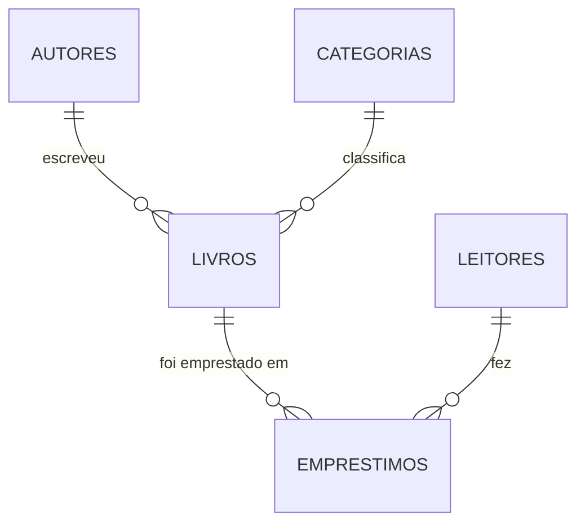

# API REST da Biblioteca

API feita com NestJS, TypeORM e PostgreSQL para controlar os livros e os
empréstimos de uma biblioteca de escola.

**Aluno:** Jefferson Korte Junior
**Disciplina:** Projeto e Desenvolvimento de Sistemas Web

---

## Como rodar

### 1. O banco

O banco sobe no Docker, então não precisa instalar o PostgreSQL na máquina.

```bash
docker compose up -d
```

Isso cria um Postgres na porta **5433**. Escolhi a 5433 e não a 5432 porque
muita máquina já tem um Postgres instalado ocupando a 5432.

Os dados ficam salvos em um volume do Docker, então eles continuam lá mesmo
depois de desligar o container.

### 2. O arquivo .env

Copie o `.env.example` para `.env` e preencha a senha:

```bash
cp .env.example .env
```

Se estiver usando o `docker-compose.yml` que está no projeto, a senha é
`postgres`. O `.env` fica fora do Git, por isso só o `.env.example` está aqui.

### 3. A API

```bash
npm install
npm run start:dev
```

A API sobe em `http://localhost:3000`.

As tabelas são criadas sozinhas na primeira vez, porque o TypeORM está com o
`synchronize: true`.

> Se a porta 3000 já estiver ocupada na sua máquina, mude o `PORT` no `.env`.

### 4. Testar

Tem um arquivo `requests.http` na raiz com todas as requisições prontas. Dá pra
rodar ele direto no VS Code com a extensão **REST Client**: aparece um
"Send Request" em cima de cada requisição.

Ele tem pelo menos um caso de sucesso de cada endpoint e um caso de erro de
cada regra de negócio. As requisições estão numeradas e precisam ser rodadas na
ordem, com o banco vazio, porque algumas dependem das anteriores.

Pra limpar o banco e começar do zero:

```bash
docker compose down -v
docker compose up -d
```

---

## O modelo de dados

A imagem do diagrama está em [docs/modelo.png](docs/modelo.png). O mesmo modelo
também está escrito em [docs/modelo.dbml](docs/modelo.dbml), que é o formato do
dbdiagram.io, caso seja mais fácil de ler ou de mexer.

São 5 tabelas:

| Tabela | O que guarda |
|---|---|
| `autores` | o nome do autor |
| `categorias` | o nome da categoria |
| `livros` | título, ano, quantos exemplares, o autor e a categoria |
| `leitores` | nome, matrícula e e-mail do aluno |
| `emprestimos` | qual livro, qual leitor, as datas e a multa |

Os relacionamentos:



Todos os relacionamentos são 1:N, e em cada um deles a chave estrangeira ficou
no lado do N:

- um autor escreveu vários livros, então `autor_id` fica em `livros`
- uma categoria tem vários livros, então `categoria_id` fica em `livros`
- um livro aparece em vários empréstimos, então `livro_id` fica em `emprestimos`
- um leitor fez vários empréstimos, então `leitor_id` fica em `emprestimos`

**Sobre os exemplares:** eu não fiz uma tabela separada pra eles. "Exemplares"
virou uma coluna com um número dentro da tabela `livros`, porque a regra do
sistema trata exemplar como quantidade e não como item: pra saber se um livro
está disponível eu faço a conta "exemplares menos empréstimos em aberto". Não
preciso saber qual cópia física saiu, só quantas sobraram.

### Por que o empréstimo é uma entidade própria e não só uma N:N?

Porque o empréstimo tem dados que são dele e de mais ninguém: a data de
retirada, a data prevista, a data em que o livro voltou e a multa. Uma ligação
N:N pura só guardaria o par livro + leitor, e esses campos não teriam onde
ficar. Além disso o mesmo leitor pode pegar o mesmo livro várias vezes ao longo
do tempo, e numa N:N simples esse par só podia existir uma vez, o que apagaria
o histórico.

---

## Os endpoints

A API responde em `http://localhost:3000`.

### Livros

| Método | Rota | O que faz | Sucesso | Erros |
|---|---|---|---|---|
| GET | `/livros` | lista os livros | 200 | 400 |
| GET | `/livros/:id` | detalhe, com o autor e a categoria | 200 | 400, 404 |
| POST | `/livros` | cadastra um livro | 201 | 400, 404 |
| PATCH | `/livros/:id` | muda os dados do livro | 200 | 400, 404 |
| DELETE | `/livros/:id` | exclui o livro | 204 | 404, 409 |

O `GET /livros` aceita três filtros na URL, e eles podem ser combinados:

| Filtro | Exemplo | O que faz |
|---|---|---|
| `categoria` | `/livros?categoria=1` | só os livros dessa categoria |
| `autor` | `/livros?autor=2` | só os livros desse autor |
| `disponivel` | `/livros?disponivel=true` | só os que têm exemplar livre |

Os filtros `categoria` e `autor` recebem o **id**, não o nome. Se vier texto no
lugar de número, a resposta é 400. O filtro `disponivel` aceita só `true` ou
`false`.

### Autores e categorias

| Método | Rota | Sucesso | Erros |
|---|---|---|---|
| GET | `/autores` | 200 | - |
| POST | `/autores` | 201 | 400 |
| GET | `/categorias` | 200 | - |
| POST | `/categorias` | 201 | 400 |

### Leitores

| Método | Rota | O que faz | Sucesso | Erros |
|---|---|---|---|---|
| POST | `/leitores` | cadastra um leitor | 201 | 400, 409 |
| GET | `/leitores/:id/emprestimos` | os empréstimos do leitor | 200 | 404 |

O 409 do cadastro acontece quando a matrícula já está cadastrada.

A listagem aceita `/leitores/:id/emprestimos?status=aberto` pra trazer só os
livros que o leitor ainda não devolveu.

### Empréstimos

| Método | Rota | O que faz | Sucesso | Erros |
|---|---|---|---|---|
| POST | `/emprestimos` | registra um empréstimo | 201 | 404, 409 |
| PATCH | `/emprestimos/:id/devolucao` | registra a devolução | 200 | 404, 409 |

No `POST /emprestimos` o corpo tem só dois campos, `livroId` e `leitorId`. As
datas quem calcula é a API.

---

## As regras de negócio

| | Regra | Onde ela está | O que acontece se quebrar |
|---|---|---|---|
| R1 | só empresta se tiver exemplar livre | `EmprestimosService` | 409 `SEM_EXEMPLAR` |
| R2 | no máximo 3 empréstimos em aberto por leitor | `EmprestimosService` | 409 `LIMITE_EMPRESTIMOS` |
| R3 | data prevista = retirada + 14 dias | `EmprestimosService` | - |
| R4 | multa de R$ 1,00 por dia de atraso | `EmprestimosService` | - |
| R5 | empréstimo devolvido não devolve de novo | `EmprestimosService` | 409 `JA_DEVOLVIDO` |
| R6 | livro com empréstimo em aberto não é excluído | `LivrosService` | 409 |

A R3 e a R4 não têm erro pra mostrar, porque elas não barram nada: uma calcula
a data e a outra calcula o valor da multa. O `requests.http` explica como ver
as duas funcionando.

---

## Como o código está organizado

```
src/
  comum/                      o que é usado pela API toda
    excecoes/                 as exceções das regras R1, R2 e R5
    datas.ts                  somar dias e contar dias de atraso
    filtro-de-excecoes.ts     monta a resposta de erro
    interceptor-de-resposta.ts  monta a resposta de sucesso
    log.middleware.ts         escreve no terminal o que foi chamado
  autores/
  categorias/
  livros/
  leitores/
  emprestimos/
```

Cada pasta de assunto tem sempre os mesmos arquivos:

- **entity** - a tabela do banco
- **dto** - o que pode vir na requisição e as regras de validação
- **repository** - o único arquivo do módulo que fala com o banco
- **service** - as regras de negócio, sem saber nada de HTTP
- **controller** - só recebe a requisição e chama o service
- **module** - junta tudo e diz o que esse módulo empresta pros outros

Quando um módulo precisa de outro, ele importa o módulo e usa o service que
aquele módulo exporta. Não tem `new` em nenhum lugar, quem monta tudo é o Nest.

Uma coisa que parece fora de lugar: a rota `/leitores/:id/emprestimos` está
num controller dentro da pasta `emprestimos`, não da pasta `leitores`. Fiz
assim porque quem conhece as regras de empréstimo é o `EmprestimosService`. Se
esse controller ficasse no módulo de leitores, os dois módulos iam precisar um
do outro e o Nest não resolve essa dependência circular.

---

## O formato das respostas

Todas as respostas saem no mesmo formato, e isso não está escrito em nenhum
controller: quem faz é um interceptor e um filtro registrados no `main.ts`.

Quando dá certo:

```json
{
  "sucesso": true,
  "dados": {
    "id": 7,
    "titulo": "Dom Casmurro"
  }
}
```

Quando dá erro:

```json
{
  "sucesso": false,
  "erro": {
    "status": 409,
    "codigo": "SEM_EXEMPLAR",
    "mensagem": "Livro 7 sem exemplar disponível"
  },
  "caminho": "/emprestimos",
  "timestamp": "2026-11-04T14:05:00.000Z"
}
```

A única resposta que não é embrulhada é o `DELETE`, porque ele devolve 204 e
pela regra do HTTP o 204 não pode ter corpo.

Se acontecer um erro que não estava previsto, a resposta é um 500 com uma
mensagem genérica. O detalhe de verdade vai só pro log do servidor, porque não
dá pra mandar stack trace pra quem está chamando a API.

Nenhum controller tem `try/catch`. Os services só jogam a exceção e o filtro
global cuida do resto.

---

## O que foi usado

- **NestJS 11** - a estrutura da API
- **TypeORM** - pra falar com o banco sem escrever SQL na mão
- **PostgreSQL 16** - o banco, rodando no Docker
- **class-validator** - as validações que ficam nos DTOs
- **@nestjs/config** - pra ler o `.env`
